# Automated Cloud Incident Response Pipeline (SOAR)

Detecting privileged group changes in Microsoft Sentinel and
automatically disabling the account with an Azure Logic Apps playbook

**Wilbert Morelos**

Built and tested September 2026

Microsoft Sentinel · Azure Logic Apps · Microsoft Entra ID · KQL

<table>
<colgroup>
<col style="width: 100%" />
</colgroup>
<tbody>
<tr class="odd">
<td>
<strong>Result</strong>

A simulated privilege escalation (adding an account to a privileged
group) was detected, turned into a Sentinel incident, and contained by
disabling the account, with <strong>no human action after the initial
change</strong>.

Final hands-off test on Sept 26, 2026: account added at <strong>12:19
AM</strong>, incident created at <strong>12:27 AM</strong>, playbook ran
at <strong>12:27 AM</strong>, account confirmed
<strong>Disabled</strong>.
</td>
</tr>
</tbody>
</table>

**Contents**

**1. Overview**

**2. How the pipeline works**

**3. Building the pipeline**

**4. Testing and troubleshooting**

Issue 1: Playbook missing from the automation rule

Issue 2: Test ran, but no incidents appeared

Issue 3: Playbook "Succeeded" but nothing was disabled

Issue 4: Update user failed with 401 Unauthorized

**5. Final verification: a hands-off run**

**6. Limitations and next steps**

**7. Key takeaways**

**Appendix: configuration reference**

# 1. Overview

This project is a hands-on Security Orchestration, Automation and
Response (SOAR) pipeline built in a personal Azure tenant. Its purpose
is to prove I can engineer automated incident handling end to end: write
a detection in KQL, turn detections into incidents, and attach a
playbook that takes a containment action without an analyst in the loop.

The scenario is a common attacker move. After compromising an ordinary
account, an attacker adds it to a privileged group to gain more access.
MITRE ATT&CK tracks this as **Account Manipulation** under the
**Persistence** tactic. In this lab, the security group
**Simulated-Employees** stands in for a privileged group such as an
admin group. Any account added to it is treated as suspicious and is
locked out immediately.

## Technology used

| **Component**                              | **Role in the pipeline**                                                                                                                                    |
|--------------------------------------------|-------------------------------------------------------------------------------------------------------------------------------------------------------------|
| Microsoft Entra ID                         | Identity source. Its audit logs record the group change, and it is where the account gets disabled.                                                         |
| Log Analytics workspace (law-soar-project) | Stores the Entra ID audit logs (AuditLogs table) that the detection queries.                                                                                |
| Microsoft Sentinel                         | SIEM layer: scheduled analytics rule, incidents, and the automation rule that launches the playbook. Managed through the unified Microsoft Defender portal. |
| KQL                                        | The detection logic, plus extracting the affected account so the playbook knows who to act on.                                                              |
| Azure Logic Apps (la-soar-containment)     | The SOAR playbook. Receives the incident, finds the account, and disables it through the Entra ID connector.                                                |

# 2. How the pipeline works

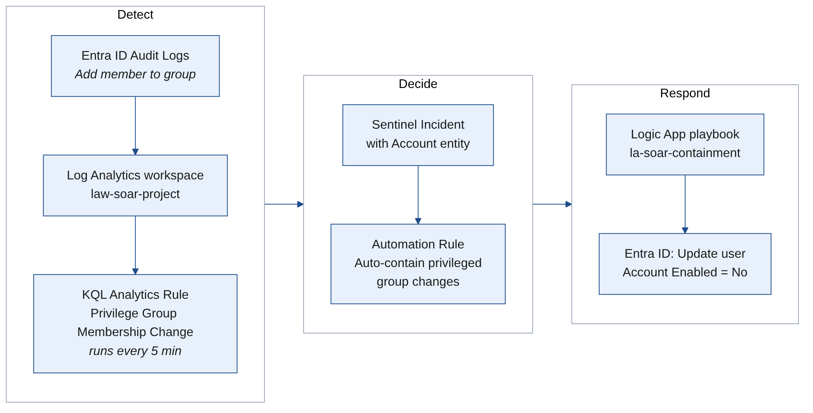

**Figure 1.** End-to-end flow: detect, decide, respond.

1.  **Event.** Someone adds a user to the Simulated-Employees group.
    Entra ID writes an "Add member to group" entry to its audit log.

2.  **Ingestion.** The Entra ID data connector streams audit logs into
    the law-soar-project Log Analytics workspace.

3.  **Detection.** Every 5 minutes, the scheduled analytics rule
    "Privilege Group Membership Change" runs a KQL query looking for
    additions to that group. It also extracts the added user and maps it
    as an Account entity.

4.  **Incident.** Each match becomes a Medium-severity incident in
    Sentinel, carrying the added account as structured entity data.

5.  **Automation.** The automation rule "Auto-contain privileged group
    changes" fires when an incident from that analytics rule is created
    and runs the playbook.

6.  **Containment.** The Logic App pulls the account entities out of the
    incident, loops over them, and calls Entra ID "Update user" with
    Account Enabled = No.

The incident stays open after containment so an analyst can review it
and re-enable the account if the change turns out to be legitimate.
Disabling (rather than deleting) keeps the account, its group
memberships and its logs intact for investigation and makes the action
fully reversible.

# 3. Building the pipeline

## Step 1: Lab environment

I used a personal Azure tenant on the free trial because the
school-managed tenant did not grant the admin rights this project needs.
Setup included Entra ID, a **break-glass Global Administrator** account,
three test users (Alice Smith, John Doe, Mike Wilson), the
**Simulated-Employees** security group, and a budget alert to avoid
surprise charges.

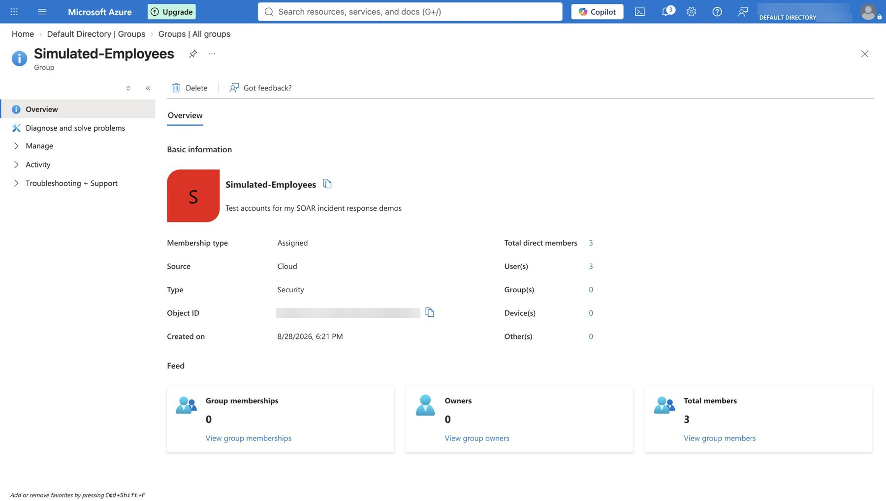

**Figure 2.** The Simulated-Employees group, standing in for a
privileged group. Its Object ID is also used in the detection query.

## Step 2: Log pipeline

I created the Log Analytics workspace law-soar-project in resource group
rg-soar-project, enabled Microsoft Sentinel on it, and connected the
**Microsoft Entra ID** data connector so audit logs flow into the
AuditLogs table.

## Step 3: Detection rule

The scheduled analytics rule **Privilege Group Membership Change** runs
every 5 minutes, is mapped to MITRE ATT&CK **Persistence**, uses Medium
severity, and is set to create incidents. The original query matched the
group by name or by Object ID:

> AuditLogs
>
> \| where OperationName == "Add member to group"
>
> \| where TargetResources has "Simulated-Employees"
>
> or TargetResources has "<GROUP-OBJECT-ID>"
>
> \| project TimeGenerated, OperationName, InitiatedBy, TargetResources
>
> \| order by TimeGenerated desc

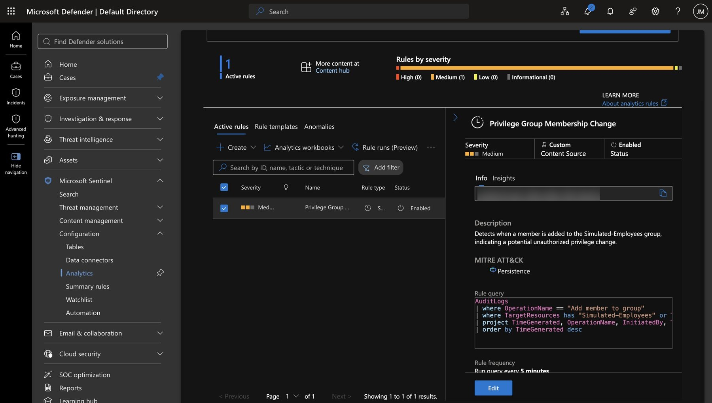

**Figure 3.** The enabled analytics rule with its original query (later
revised, see Issue 3).

## Step 4: Containment playbook

The first version of la-soar-containment used the **Microsoft Sentinel
alert** trigger, parsed the alert entities with **Parse JSON**, and
looped over them into an Entra ID **Update user** action with **Account
Enabled = No**. It looked right in the designer, but it could not be
attached to an automation rule (see Issue 1).

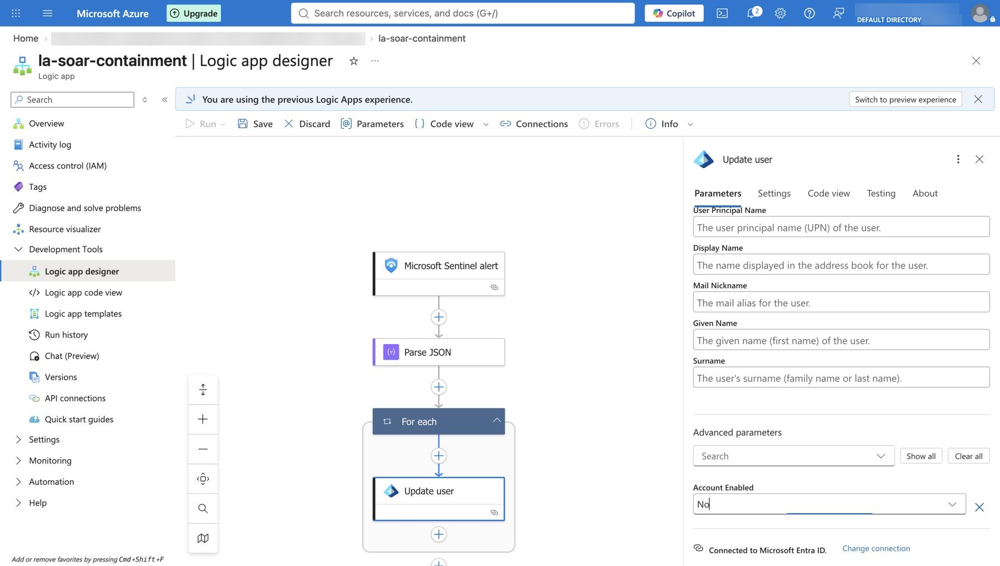

**Figure 4.** First version: alert trigger, Parse JSON, For each, Update
user with Account Enabled set to No.

The final version is built on the **Microsoft Sentinel incident**
trigger. **Entities - Get Accounts** pulls the account entities from the
incident, a **For each** loop iterates over them, and **Update user**
disables each one. The user is identified by **Accounts Microsoft Entra
ID user ID**, the account's object ID, which is more reliable than
rebuilding a UPN string.

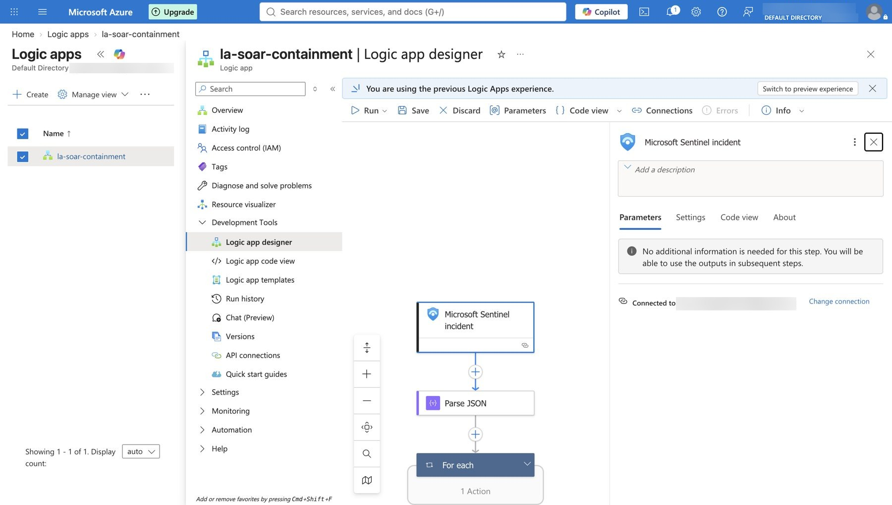

**Figure 5.** Rebuilt playbook on the Microsoft Sentinel incident
trigger.

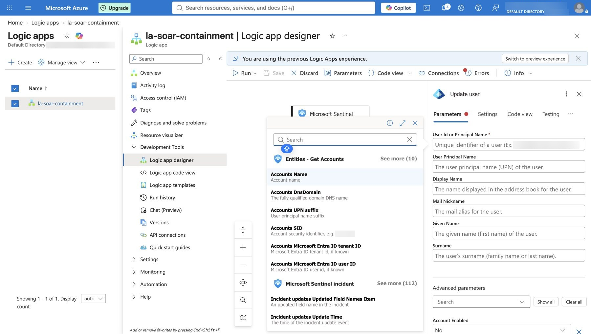

**Figure 6.** Selecting the account's Entra ID user ID as the input for
Update user.

## Step 4b: Automation rule

The automation rule ties detection to response. Trigger: **When incident
is created**. Condition: **Analytic rule name contains Privilege Group
Membership Change**. Action: **Run playbook \`la-soar-containment\`**.

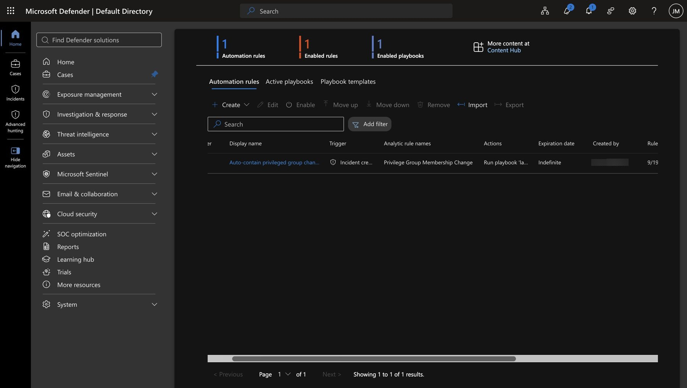

**Figure 7.** Automation rule saved and enabled: 1 automation rule, 1
enabled rule, 1 enabled playbook.

# 4. Testing and troubleshooting

Most of the learning happened here. Each configuration looked correct in
isolation, and the problems only showed up when testing the whole chain.
Each issue below lists the symptom, the root cause and the fix.

## Issue 1 Playbook missing from the automation rule

**Symptom:** When creating the automation rule, the Playbook dropdown
was empty ("No results match your search criteria"), even though the
playbook was enabled.

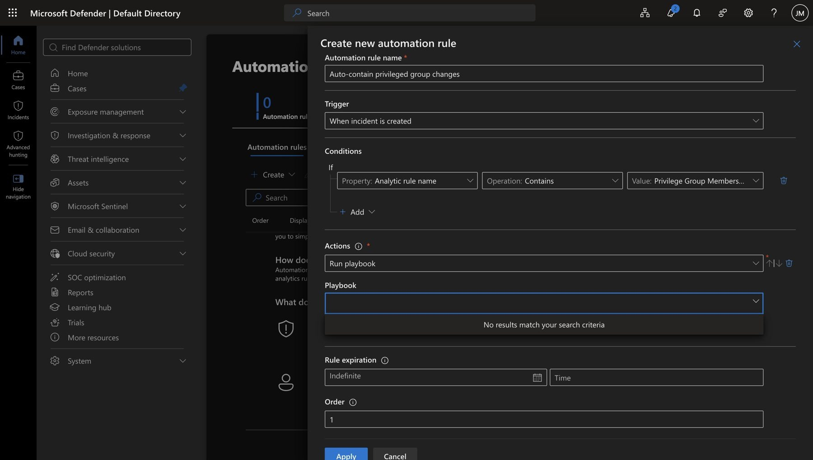

**Figure 8.** Empty playbook list when configuring the Run playbook
action.

**Root cause A:** Sentinel runs playbooks through its own service
account, which needs permission on the resource group that holds the
playbook. It had none.

**Fix A:** Assigned the **Microsoft Sentinel Automation Contributor**
role on rg-soar-project to the **Azure Security Insights** service
principal.

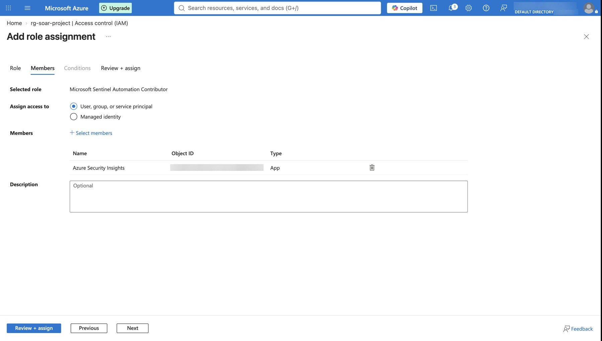

**Figure 9.** Granting Sentinel permission to run playbooks in the
resource group.

**Root cause B:** The playbook still did not appear. Automation rules
can only run playbooks that start with the **incident** trigger, and
mine used the **alert** trigger.

**Fix B:** Rebuilt the front of the playbook on the Microsoft Sentinel
incident trigger and replaced Parse JSON with Entities - Get Accounts
(Step 4). After that, the playbook appeared and the automation rule was
created.

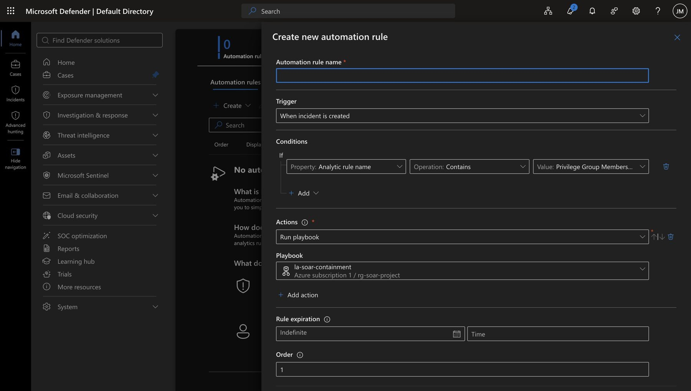

**Figure 10.** la-soar-containment now available in the automation rule.

## Issue 2 Test ran, but no incidents appeared

**Setup:** The three original test users were already in the group, so
re-checking them would not generate a new "Add member to group" event. I
created a fresh account, **Test Attacker**, and added it to
Simulated-Employees as the simulated attack.

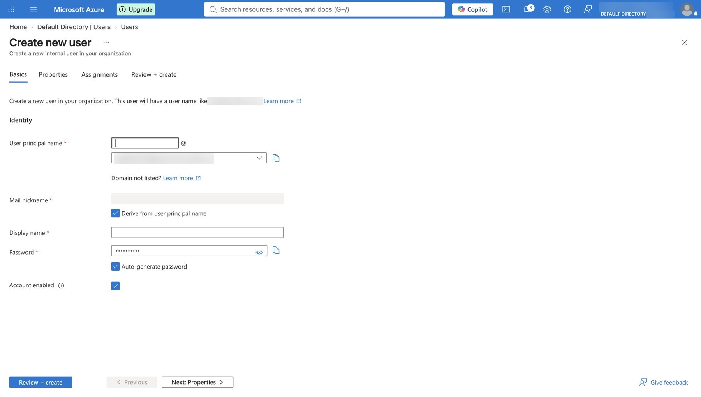

**Figure 11.** Creating the Test Attacker account for the simulation.

**Symptom:** The Defender Incidents queue showed 0 incidents.

**Investigation:** Rather than guess, I checked each layer. Running the
detection logic in **Advanced hunting** returned the group-add events,
including the 7:21 AM Test Attacker addition, so the raw data existed.
The rule's Incident settings confirmed incident creation was enabled.
The Rule runs view only shows runs 90 minutes after they complete, so it
could not help in real time.

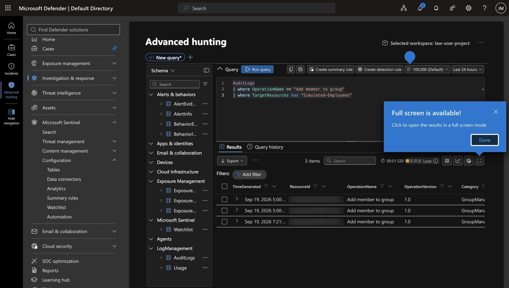

**Figure 12.** Advanced hunting confirms the audit events reached the
workspace.

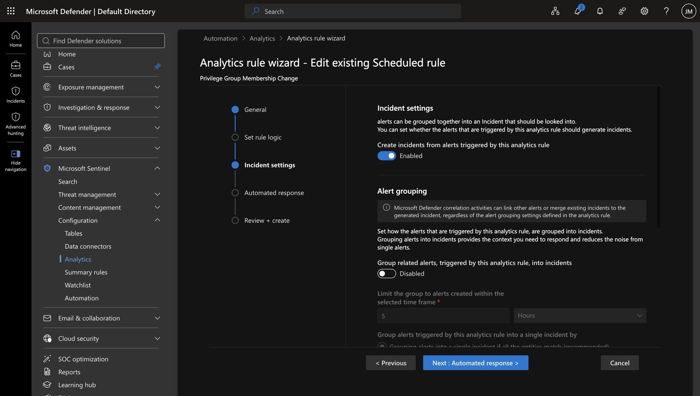

**Figure 13.** Incident creation enabled on the analytics rule.

**Root cause:** The incidents existed (the Sentinel overview counted 3).
The Incidents queue's default filters, especially **Priority score:
15-100**, hid them. Log ingestion delay also meant the first scheduled
runs fired before the event had arrived.

**Fix:** Cleared the filters. Three "Privilege Group Membership Change"
incidents appeared, one per group addition, since alert grouping is
disabled on the rule.

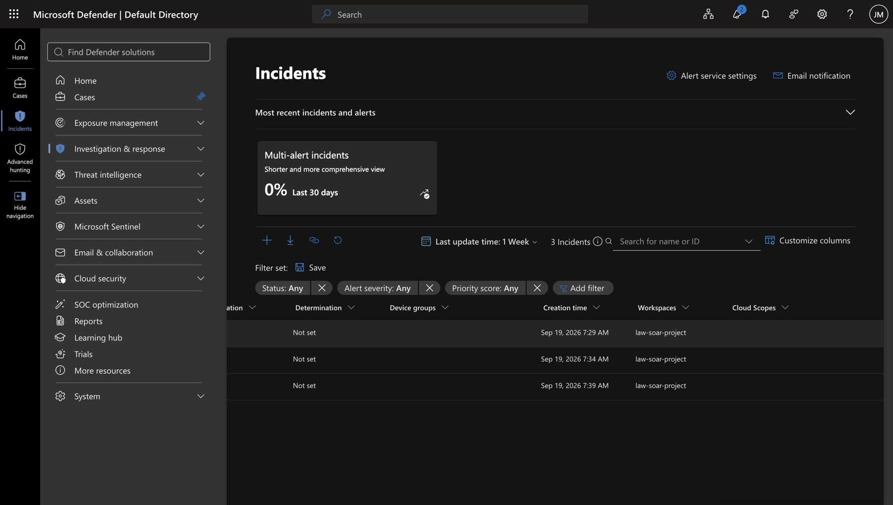

**Figure 14.** Incidents visible after removing the default queue
filters.

## Issue 3 Playbook "Succeeded" but nothing was disabled

**Symptom:** The Logic App run history showed three green, successful
runs that matched the incidents. But Test Attacker's account was still
**Enabled**.

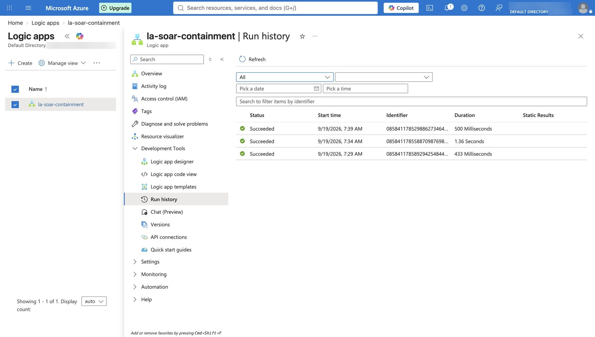

**Figure 15.** Three successful playbook runs.

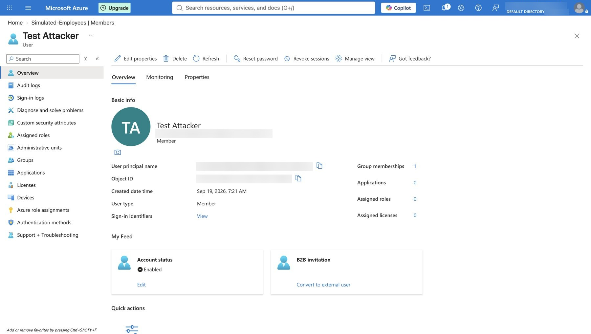

**Figure 16.** Yet the Test Attacker account was still enabled.

**Root cause:** Opening a run showed **Entities - Get Accounts**
received an empty list (\[\]). The analytics rule had **no entity
mapping**, so incidents carried no account data. The loop ran zero
times, Update user never executed, and Azure reported success because
nothing failed.

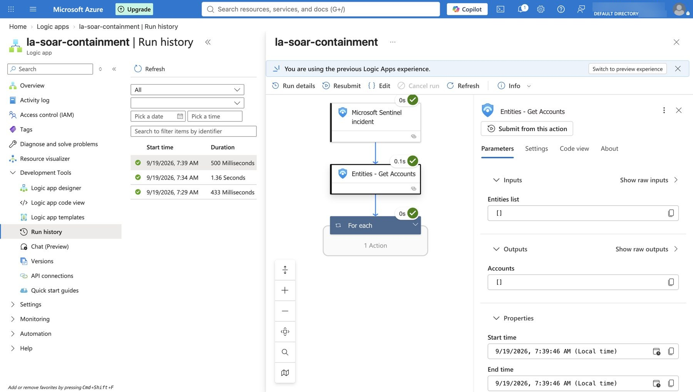

**Figure 17.** The run trace: Entities list and Accounts are both empty.

**Fix:** Rewrote the query to expand TargetResources and pull out the
**added user** as clean columns (AddedUserUPN, AddedUserId), then mapped
an **Account** entity with identifier **AadUserId** to AddedUserId.

<table>
<colgroup>
<col style="width: 100%" />
</colgroup>
<tbody>
<tr class="odd">
<td>
<strong>Design decision: target, not actor</strong>

The original query exposed InitiatedBy, which records <strong>who
made the change</strong>. In this test that was my own admin account.
Mapping containment to that field would have disabled the administrator
instead of the account being escalated, a self-lockout risk. The revised
query deliberately targets the account that <strong>was
added</strong>.
</td>
</tr>
</tbody>
</table>

> AuditLogs
>
> \| where OperationName == "Add member to group"
>
> \| where TargetResources has "Simulated-Employees"
>
> or TargetResources has "<GROUP-OBJECT-ID>"
>
> \| mv-expand TargetResources
>
> \| where TargetResources.type == "User"
>
> \| extend AddedUserUPN = tostring(TargetResources.userPrincipalName)
>
> \| extend AddedUserId = tostring(TargetResources.id)
>
> \| project TimeGenerated, OperationName, InitiatedBy, AddedUserUPN,
> AddedUserId
>
> \| order by TimeGenerated desc

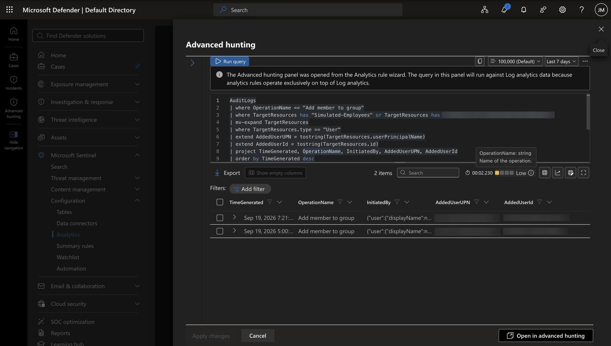

**Figure 18.** Revised query returns the added user's UPN and object ID,
separate from the initiator.

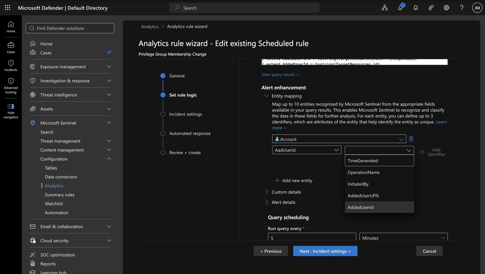

**Figure 19.** Entity mapping: Account, identifier AadUserId mapped to
AddedUserId.

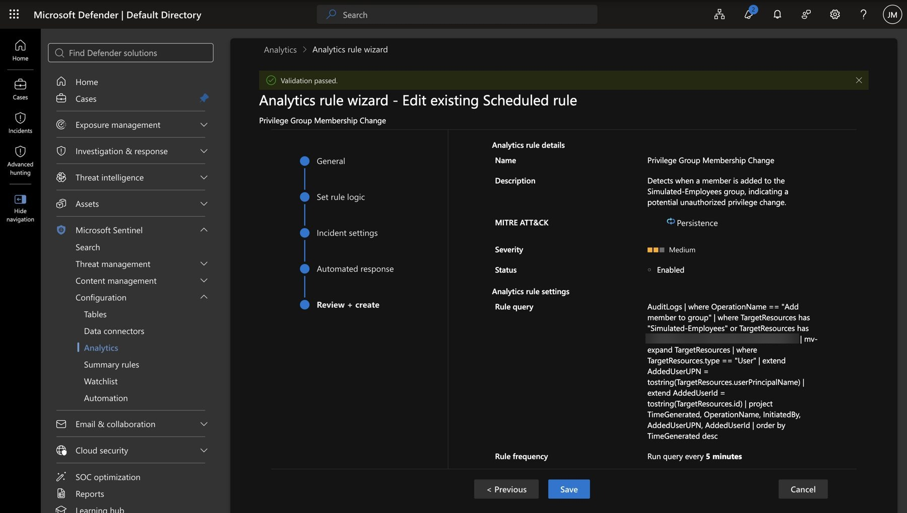

**Figure 20.** Rule validation passed with the new query.

**Result:** The next incident (ID 4) listed **Test Attacker** as an
entity, and the playbook run now received the real account, including
its aadUserId.

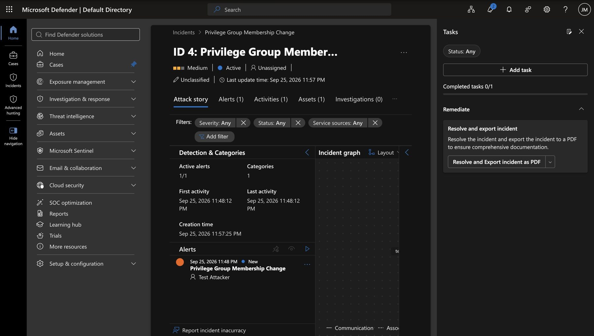

**Figure 21.** Incident 4 now carries Test Attacker as an Account
entity.

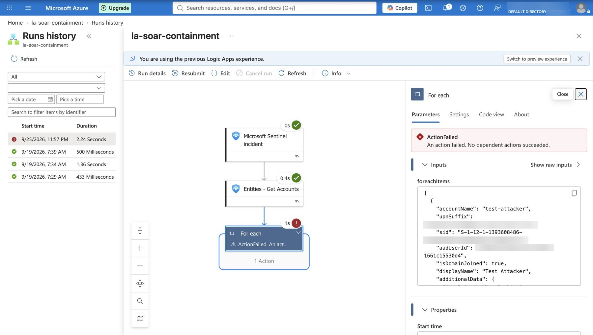

**Figure 22.** Entities - Get Accounts returns the Test Attacker
account; the failure moved to the next step.

## Issue 4 Update user failed with 401 Unauthorized

**Symptom:** With the right account flowing in, **Update user** failed
with status **401 Unauthorized**. Its input was exactly Test Attacker's
object ID, so the data was correct; the problem was the identity
performing the action.

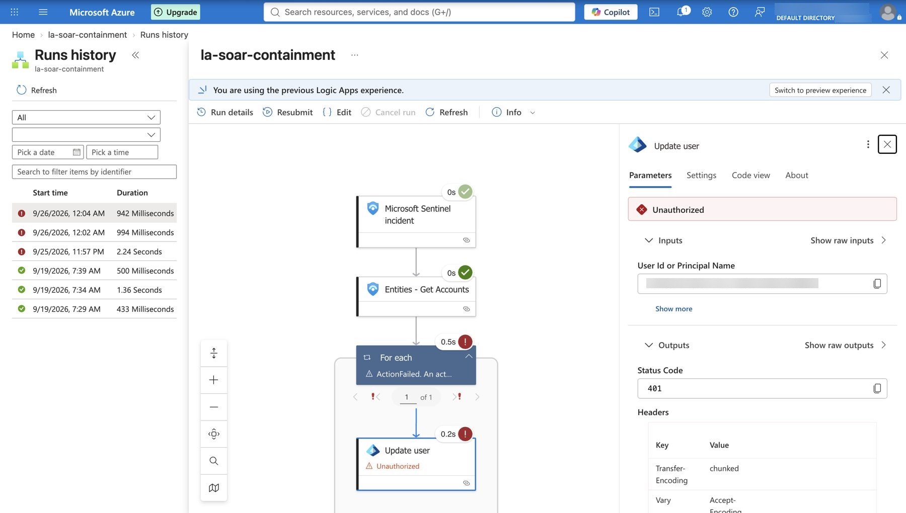

**Figure 23.** Update user received the correct object ID but returned
401.

**Root cause:** The Entra ID connection was authorized with my
**personal Microsoft account** (shown as live.com#...), an external
identity signed into the tenant. It works in the portal, but Microsoft
Graph rejected it when the connector acted on its behalf. Re-authorizing
with the same account changed nothing.

**Fix:** Re-authorized the azuread connection with the native
**break-glass Global Administrator** account. That required resetting
its password and enrolling MFA, because the tenant has Security Defaults
on.

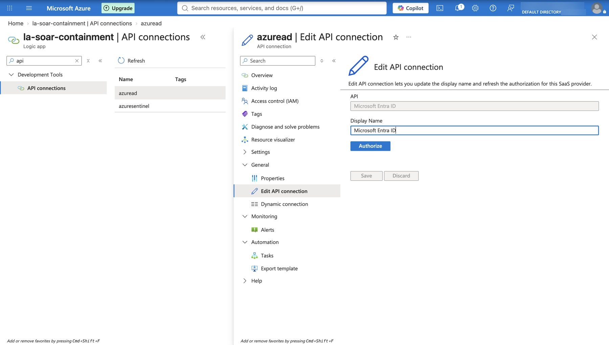

**Figure 24.** Re-authorizing the Microsoft Entra ID API connection.

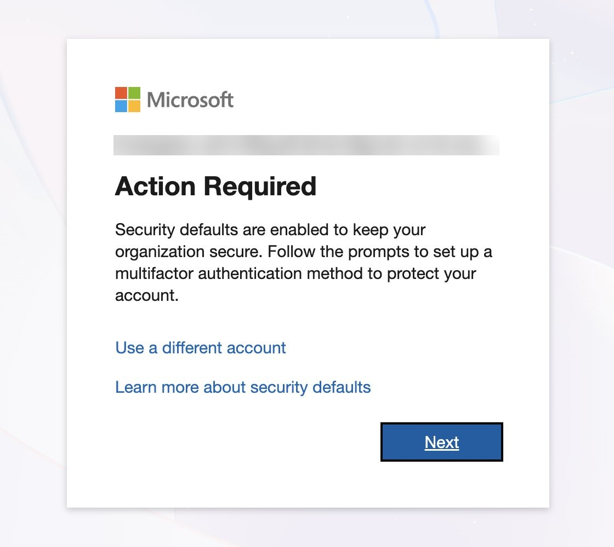

**Figure 25.** Security Defaults required MFA setup for the break-glass
account.

**One more catch:** Runs still failed after the first attempt. The
connection's **Last update time** had not changed, which showed the MFA
setup had interrupted the flow before the new account was saved. I
authorized again and made sure to click **Save**.

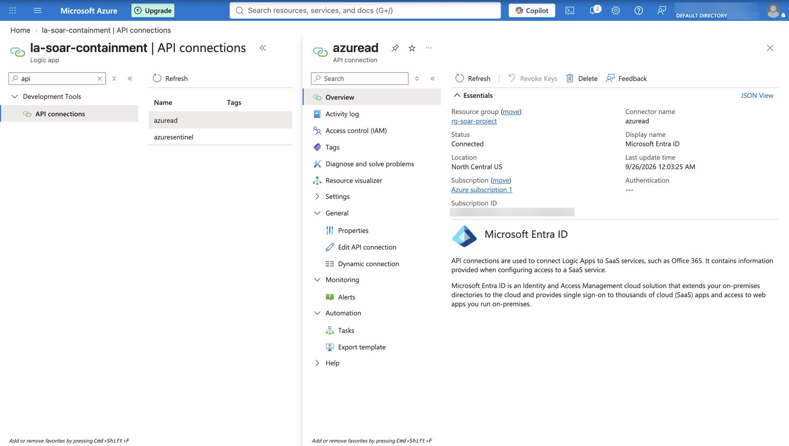

**Figure 26.** The unchanged Last update time revealed the switch never
saved.

**Result:** The resubmitted run at 12:16 AM completed with every step
green, including Update user.

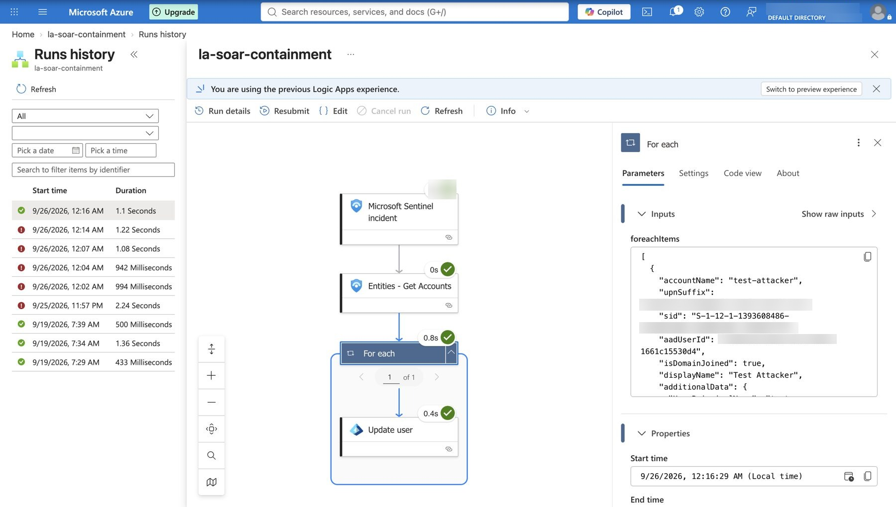

**Figure 27.** First fully successful run: Update user completes.

# 5. Final verification: a hands-off run

The 12:16 AM success came from a manual resubmit, so it did not prove
the pipeline runs on its own. For a clean test, I re-enabled Test
Attacker, removed it from Simulated-Employees, added it back, and then
took no further action.

| **Time (Sept 26, 2026)** | **What happened**                                                                          |
|--------------------------|--------------------------------------------------------------------------------------------|
| 12:19:25 AM              | Test Attacker added to Simulated-Employees (the simulated attack).                         |
| 12:27:21 AM              | Analytics rule detects the change and creates Incident 7 with Test Attacker as the entity. |
| 12:27 AM                 | Automation rule runs la-soar-containment automatically. All steps succeed (1.76 s).        |
| After the run            | Test Attacker's account status is Disabled.                                                |

About 8 minutes passed from the change to containment, made up of the
5-minute rule schedule plus log ingestion delay. No person touched the
system after the group change.

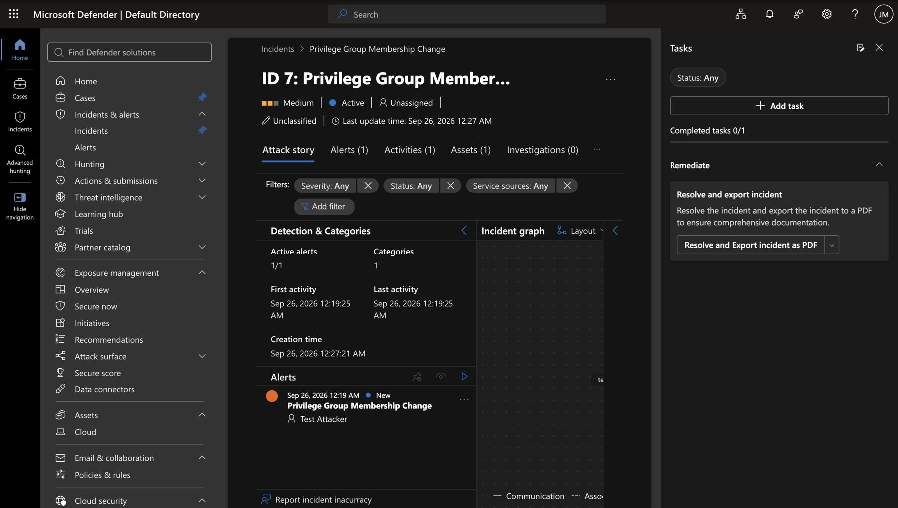

**Figure 28.** Proof 1: Incident 7 created automatically, with Test
Attacker attached.

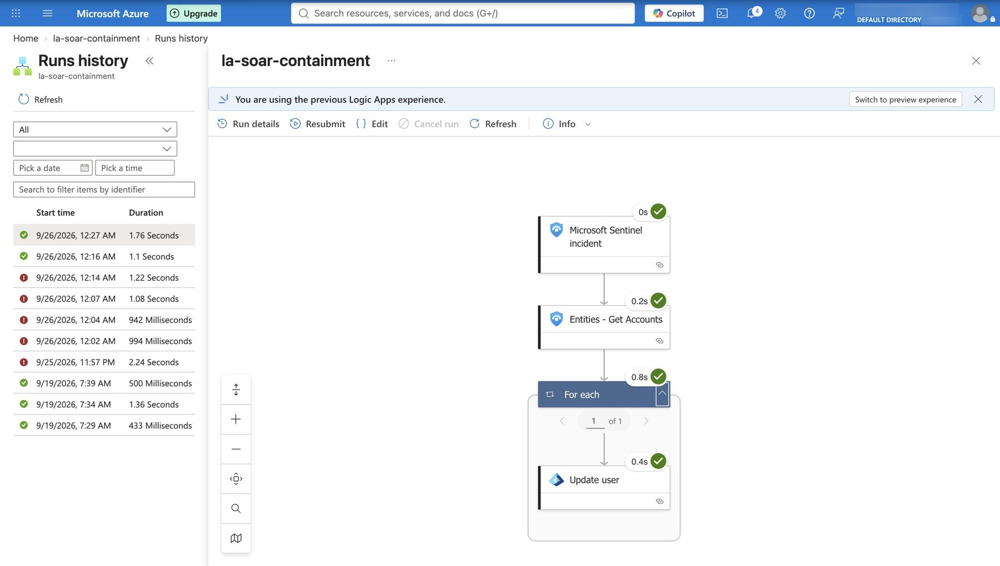

**Figure 29.** Proof 2: the 12:27 AM playbook run, not a resubmit, with
every step green.

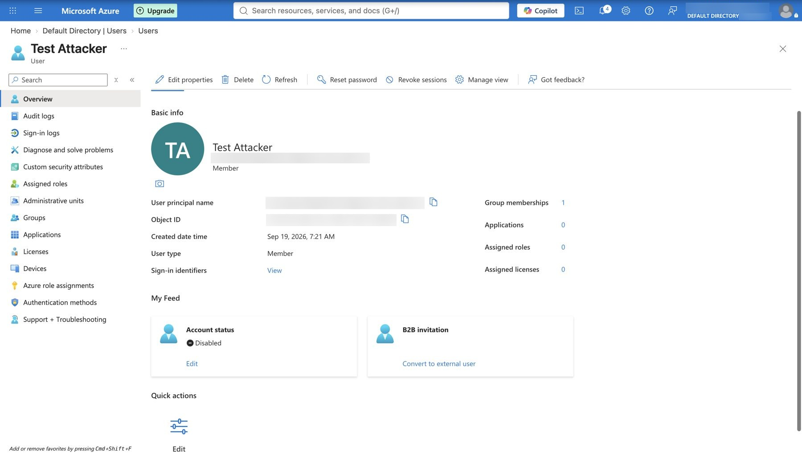

**Figure 30.** Proof 3: Test Attacker's account status is Disabled.

# 6. Limitations and next steps

This is a starter lab. Real environments run many playbooks and add
safeguards. These are the gaps I would close next:

| **Limitation**                                                                                                       | **Improvement**                                                                                                                          |
|----------------------------------------------------------------------------------------------------------------------|------------------------------------------------------------------------------------------------------------------------------------------|
| Detection takes minutes (5-minute schedule plus ingestion delay; about 8 minutes in testing).                        | Use a near-real-time (NRT) analytics rule for faster detection.                                                                          |
| Every added account is disabled, including legitimate changes by real admins.                                        | Add an allowlist of approved initiators, or an approval step (for example, a Teams prompt) before disabling.                             |
| Disabling the account does not end sessions that are already signed in.                                              | Also revoke sign-in sessions and remove the account from the privileged group.                                                           |
| The connector runs as the break-glass Global Administrator. Break-glass accounts should stay unused for emergencies. | Give the Logic App a managed identity and call Microsoft Graph with a least-privilege permission scoped to enabling and disabling users. |
| Analysts are not notified, and incidents are not updated with what happened.                                         | Add an incident comment and a notification step to the playbook.                                                                         |

# 7. Key takeaways

- **"Succeeded" does not mean it worked.** The playbook reported success
  while doing nothing. Verifying the real outcome (the account status)
  is what exposed the missing entity mapping.

- **Act on the target, not the actor.** Choosing the wrong identity
  field could have disabled the administrator instead of the escalated
  account.

- **Permissions come in layers.** Sentinel needed RBAC to run playbooks,
  and the Logic App connection needed an identity Microsoft Graph would
  accept. Each layer failed separately.

- **Trigger type matters.** Automation rules can only call playbooks
  built on the incident trigger.

- **Check each layer before changing things.** Advanced hunting,
  incident settings and run traces narrowed every problem down to one
  cause.

## Project summary

<table>
<colgroup>
<col style="width: 100%" />
</colgroup>
<tbody>
<tr class="odd">
<td>
<strong>In one paragraph</strong>

I built an automated response pipeline in Microsoft Sentinel that
detects when an account is added to a privileged group, a common
privilege escalation technique. A KQL analytics rule creates an incident
with the added account mapped as an entity, an automation rule triggers
a Logic Apps playbook, and the playbook disables that account in Entra
ID with no analyst involvement. The incident stays open so an analyst
can investigate and re-enable the account if the change was legitimate.
Along the way I resolved trigger, RBAC, entity mapping and connector
authentication issues, and validated the result with a fully hands-off
test.
</td>
</tr>
</tbody>
</table>

# Appendix: configuration reference

| **Item**                | **Value**                                                                                                                                             |
|-------------------------|-------------------------------------------------------------------------------------------------------------------------------------------------------|
| Resource group          | rg-soar-project                                                                                                                                       |
| Log Analytics workspace | law-soar-project                                                                                                                                      |
| Data connector          | Microsoft Entra ID (Audit Logs)                                                                                                                       |
| Analytics rule          | Privilege Group Membership Change. Scheduled, every 5 minutes, Medium severity, MITRE ATT&CK Persistence, creates incidents, alert grouping disabled. |
| Entity mapping          | Account: AadUserId = AddedUserId                                                                                                                      |
| Automation rule         | Auto-contain privileged group changes. When incident is created, analytic rule name contains "Privilege Group Membership Change", run playbook.       |
| Playbook                | la-soar-containment: Microsoft Sentinel incident trigger, Entities - Get Accounts, For each, Update user (Account Enabled = No)                       |
| API connections         | azuresentinel, azuread (authorized as the break-glass admin)                                                                                          |
| Sentinel permission     | Microsoft Sentinel Automation Contributor for Azure Security Insights on rg-soar-project                                                              |
| Monitored group         | Simulated-Employees (Object ID <GROUP-OBJECT-ID>)                                                                                  |
| Test account            | Test Attacker (test-attacker@<tenant>.onmicrosoft.com)                                                                                      |

## Final detection query

> AuditLogs
>
> \| where OperationName == "Add member to group"
>
> \| where TargetResources has "Simulated-Employees"
>
> or TargetResources has "<GROUP-OBJECT-ID>"
>
> \| mv-expand TargetResources
>
> \| where TargetResources.type == "User"
>
> \| extend AddedUserUPN = tostring(TargetResources.userPrincipalName)
>
> \| extend AddedUserId = tostring(TargetResources.id)
>
> \| project TimeGenerated, OperationName, InitiatedBy, AddedUserUPN,
> AddedUserId
>
> \| order by TimeGenerated desc
